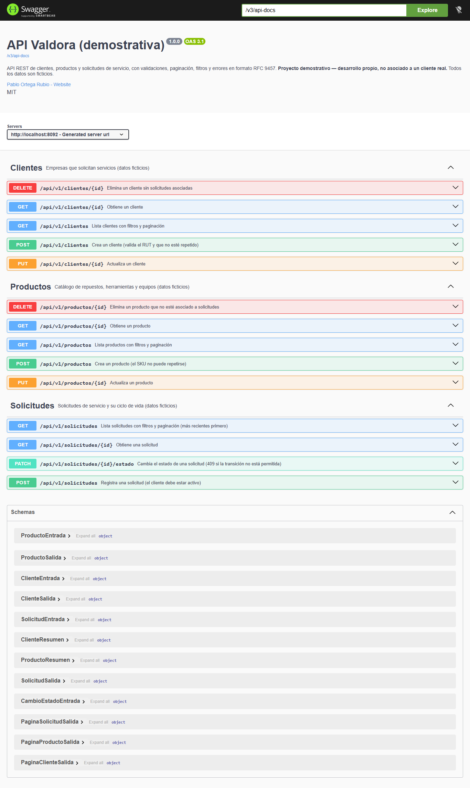
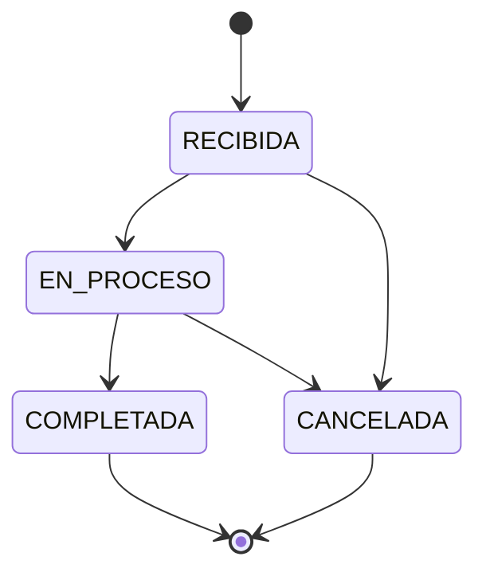
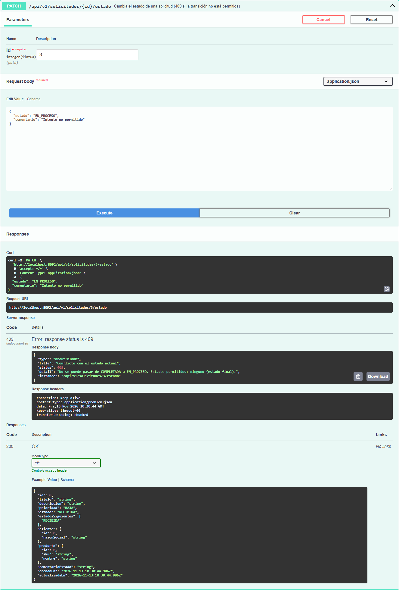
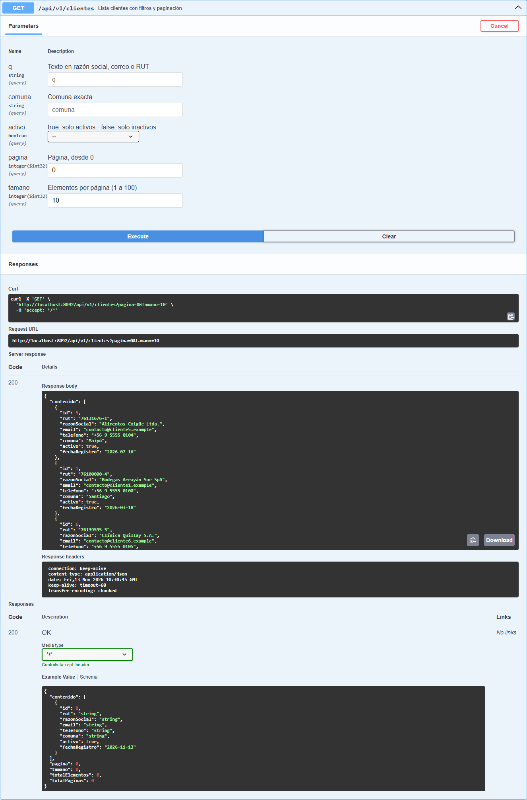
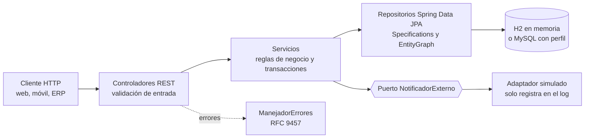

# API REST con Spring Boot · Valdora

> **Proyecto demostrativo — desarrollo propio, no asociado a un cliente real.**
> «Valdora» es una empresa ficticia. Los clientes, productos y solicitudes son datos de ejemplo.



## Qué problema resuelve

Cuando una empresa necesita conectar su sitio web, una aplicación móvil o un ERP con sus datos, necesita una **API confiable**: que valide lo que recibe, responda errores claros, pagine y filtre resultados, esté documentada y tenga pruebas. Esta API gestiona clientes, productos y **solicitudes de servicio con un ciclo de vida controlado**, y avisa a un sistema externo en cada cambio.

## Funcionalidades

- **CRUD de clientes y productos**, con búsqueda, filtros y paginación estable.
- **Solicitudes de servicio** con máquina de estados: una transición no permitida responde **409** e indica los estados válidos.
- **Validaciones:** RUT chileno con dígito verificador, correo, teléfono, SKU, precio en pesos y stock. No se permiten RUT ni SKU duplicados.
- **Errores centralizados** en formato Problem Details (RFC 9457), con detalle por campo y sin trazas internas.
- **Integración con un sistema externo** a través de un puerto (`NotificadorExterno`). La implementación incluida es una **simulación** que solo escribe en el log: no envía datos ni usa credenciales. Si el sistema externo falla, la operación principal igual se guarda.
- **Rendimiento:** las solicitudes cargan cliente y producto en una sola consulta (`@EntityGraph`, sin N+1).
- **Operación:** documentación OpenAPI y Swagger UI, `/actuator/health`, perfil para MySQL y colección Postman.

## Endpoints

| Método | Ruta | Descripción |
|---|---|---|
| GET | `/api/v1/clientes` | Lista con `q`, `comuna`, `activo`, `pagina` y `tamano` |
| GET · PUT · DELETE | `/api/v1/clientes/{id}` | Obtener, actualizar o eliminar (409 si tiene solicitudes) |
| POST | `/api/v1/clientes` | Crear (201 + `Location`) |
| GET | `/api/v1/productos` | Lista con `q`, `categoria`, `activo`, `pagina` y `tamano` |
| GET · PUT · DELETE | `/api/v1/productos/{id}` | Obtener, actualizar o eliminar |
| POST | `/api/v1/productos` | Crear |
| GET | `/api/v1/solicitudes` | Lista con `estado`, `prioridad`, `clienteId`, `desde` y `hasta` |
| GET | `/api/v1/solicitudes/{id}` | Obtener |
| POST | `/api/v1/solicitudes` | Registrar (el cliente debe estar activo) |
| PATCH | `/api/v1/solicitudes/{id}/estado` | Cambiar el estado (409 si la transición no está permitida) |



Ejemplo real de error (transición no permitida):

```json
{
  "type": "about:blank",
  "title": "Conflicto con el estado actual",
  "status": 409,
  "detail": "No se puede pasar de COMPLETADA a EN_PROCESO. Estados permitidos: ninguno (estado final).",
  "instance": "/api/v1/solicitudes/3/estado"
}
```

Más ejemplos con respuestas reales (200, 201, 400 y 409) están en [`docs/ejemplos-respuestas.md`](docs/ejemplos-respuestas.md).

| Error 409 en Swagger UI | Listado paginado |
|---|---|
|  |  |

## Arquitectura



Organización por funcionalidad (`cliente`, `producto`, `solicitud` e `integracion`). Las entradas y salidas son `record` separados de las entidades, así que la API no expone el modelo de persistencia.

## Tecnologías

Java 21 · Spring Boot 3.5 (Web, Data JPA, Validation y Actuator) · springdoc-openapi 2.8 · H2 · MySQL (perfil) · JUnit 5 · Mockito · AssertJ · JaCoCo · Maven (con wrapper) · Docker · GitHub Actions.

## Cómo ejecutarla

Requisito: JDK 21. El proyecto incluye el wrapper de Maven.

```bash
./mvnw spring-boot:run          # Windows: mvnw.cmd spring-boot:run
```

- Swagger UI: http://localhost:8081/swagger-ui.html
- OpenAPI (JSON): http://localhost:8081/v3/api-docs (copia en [`docs/openapi.json`](docs/openapi.json))
- Salud: http://localhost:8081/actuator/health
- Postman: importa [`docs/postman/valdora-api.postman_collection.json`](docs/postman/valdora-api.postman_collection.json)

Al iniciar se cargan 8 clientes, 10 productos y 12 solicitudes ficticias (se desactiva con `app.datos-demo=false`).

**MySQL y Docker:** `compose.yaml` levanta MySQL 8.4 y la API con el perfil `mysql`. Las credenciales se leen de `.env` (ver `.env.example`). *Estos archivos están incluidos, pero no se ejecutaron en el entorno donde se verificó el proyecto.*

## Pruebas

```bash
./mvnw verify          # pruebas + cobertura en target/site/jacoco/index.html
```

**Resultado verificado: 40 pruebas, 40 aprobadas, 0 fallidas** (13-11-2026, JDK 21, Windows 10, ejecutadas con `mvnw`). Cobertura JaCoCo: **95,1 % de líneas** y **82,7 % de ramas**.

| Tipo | Clase | Pruebas | Qué cubre |
|---|---|---|---|
| Unitaria | `EstadoSolicitudTest` | 9 | Todas las transiciones del ciclo de vida |
| Unitaria con Mockito | `SolicitudServiceTest` | 7 | Cliente inexistente o inactivo, transición inválida, aviso al sistema externo y tolerancia a su falla, fechas invertidas |
| Unitaria con Mockito | `ClienteServiceTest` | 3 | Normalización, RUT duplicado, no eliminar con historial |
| Unitaria | `NotificadorRegistroTest` | 1 | El log nunca muestra un correo completo |
| Web (`@WebMvcTest`) | `ClienteControllerTest` | 7 | 201 con `Location`, 400, 404 y 409 en formato RFC 9457, JSON mal formado, paginación |
| Repositorio (`@DataJpaTest`) | `SolicitudRepositoryTest` | 3 | Filtros, rango de fechas inclusivo y carga con `EntityGraph` |
| Integración (`@SpringBootTest`) | `ApiIntegracionTest` | 8 | Ciclo de vida completo, protección del historial, duplicados, paginación, productos, errores, OpenAPI y salud |
| Integración | `DatosDemostracionTest` | 2 | Datos de ejemplo completos y con RUT válidos |

**Uso de Mockito:** solo en pruebas unitarias, para aislar repositorios y el sistema externo (`verify`, `verifyNoInteractions`, `doThrow`). Las pruebas de repositorio y de integración usan la aplicación y la base de datos reales, sin simulaciones.

## Limitaciones conocidas

- **No tiene autenticación**, porque es una API de demostración. En producción se agregaría OAuth2 o JWT con Spring Security, además de un límite de peticiones.
- La base de datos por defecto es en memoria. Para producción conviene usar migraciones (Flyway) en lugar de `ddl-auto`.

## Licencia y autor

Licencia MIT. Diseño y desarrollo: **Pablo Ortega Rubio** — desarrollo de software, automatización e integraciones · [github.com/PabloOrtegaRB](https://github.com/PabloOrtegaRB)
